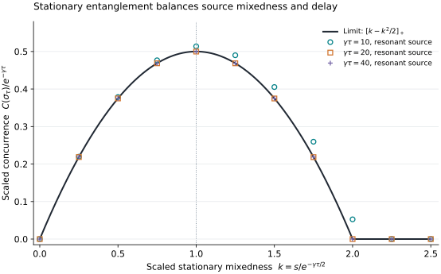

# Remote Entanglement Delay Limits

**How much simultaneous entanglement can a stationary emitter sustain with a receiver that sees its output only after a propagation delay?** This project gives an attainable bound for every causal downstream receiver and a sharp long-delay law for a statically driven two-level emitter.

The receiver may collect the entire purifying output coherently and use quantum memory and known local controls. The source has no feedback from the receiver. Entanglement is evaluated between the two nodes at the **same physical time**, in stationary operation.

## Main results

For a stationary primitive finite-dimensional Markov source with channel $`\mathcal E_t`$ and faithful stationary state $`\pi`$, every admissible equal-time source–receiver state is a receiver-local postprocessing of

```math
\sigma_\tau=(\mathcal E_\tau\otimes\mathrm{id})
\bigl(|\sqrt\pi\rangle\langle\sqrt\pi|\bigr).
```

A causal receiver with fixed finite quantum memory can approach this state arbitrarily closely under ideal full-output collection. Thus this single channel state gives the supremum of every continuous deterministic entanglement monotone on a source and an equally sized receiver output. For a fixed primitive source, the existence-of-entanglement horizon is exactly the source channel's entanglement-breaking time.

For the driven spontaneous-emission qubit

```math
\mathcal L(\rho)
=-i\left[\frac{\Omega X+\Delta Z}{2},\rho\right]
+\gamma\mathcal D[\sigma_-](\rho),
\qquad \gamma>0\text{ fixed},
```

optimizing the retained receiver qubit over all causal receivers and optimizing **all constant drive strengths and detunings** gives

```math
\boxed{\displaystyle
C_*(\tau)=\left(\frac12+o(1)\right)e^{-\gamma\tau}
\quad (\gamma\tau\to\infty).}
```

The source parameters may be retuned for each delay. The converse is uniform even over unbounded delay-dependent detunings. An asymptotically optimal resonant drive is

```math
\Omega\sim\frac{\gamma}{\sqrt2}e^{-\gamma\tau/4}.
```

The mechanism is a tradeoff: a weakly driven source retains entanglement longer, but its stationary state supplies less entanglement to begin with. With $`a=e^{-\gamma\tau/2}`$ and stationary purification concurrence $`s=2\sqrt{\det\pi}`$, the resolved tradeoff for a finite limiting ratio $`k\ge0`$ is

```math
\frac{s}{a}\to k
\quad\Longrightarrow\quad
\frac{C(\sigma_\tau)}{a^2}
\to\max\left\{0,k-\frac{k^2}{2}\right\}.
```

Its unique optimal ratio is $`k=1`$. A standard matched receiver qubit attains the fixed-source envelope in its late-time limit; no larger downstream device can improve the unconditional two-qubit score.



The points are exact-channel numerical evaluations for resonant sources with $`s=ke^{-\gamma\tau/2}`$; the curve is the proved limiting law. Finite-delay values can exceed the limiting coefficient. These samples illustrate convergence and do not assert a globally optimal finite-delay drive. [Reproduce the figure](verification/README.md#figure).

## Read the science

Start with the [question, model and exact claims](science/model.md). The [causal bound](science/causal-bound.md) explains why every receiver lies below the same envelope. [Attainability](science/attainability.md) constructs the receiver, while [receiver resources](science/receiver-resources.md) makes the physical costs and time conventions explicit. The [driven-qubit account](science/driven-qubit.md) supplies the exact finite-delay formula, and the [long-delay proof](science/long-delay-law.md) establishes the uniform optimized asymptotic.

| To inspect | Read |
|---|---|
| Assumptions, score, order of limits and central result | [Model](science/model.md) |
| Arbitrary causal receivers and the entanglement-breaking horizon | [Causal bound](science/causal-bound.md) |
| Continuous-time finite-memory construction and matched qubit receiver | [Attainability](science/attainability.md) |
| Collection, control, preparation and equal-time interpretation | [Receiver resources](science/receiver-resources.md) |
| Exact stationary state, Choi matrix and concurrence | [Driven qubit](science/driven-qubit.md) |
| All-detuning converse, optimal tuning and weak-source horizon | [Long-delay law](science/long-delay-law.md) |
| Established ingredients and nearby physical models | [Related work](references/RELATED_WORK.md) |
| Reproducible calculations and their limits | [Verification](verification/README.md) |

The [LLM reading guide](llms.txt) maps questions to their authoritative accounts.

## Learn the project

The selected educational anchor is **Crispin Gardiner and Peter Zoller, _Quantum Noise_, third edition (Springer, 2004)**. The [source bridge](learning/QUANTUM_NOISE_BRIDGE.md) starts from input–output fields, master equations and cascaded systems, translates the conventions used here, and supplies the steps from those foundations to the delay frontier.

The [30-milestone map](learning/MILESTONES.md) follows the scientific story in two phases: the background needed to formulate the stationary causal problem, then the receiver bound, attainability construction and optimized qubit law. It is a common understanding route for any reader; the [science pages](science/model.md) remain the authoritative statements and proofs.

## Reproduce the calculations

From the repository root:

```bash
python3 -m pip install -r requirements-verification.txt
python3 verification/run_all.py
```

The checks compare independent channel representations, test the receiver construction, and evaluate delicate concurrence and partial-transpose calculations at high precision. Finite computations check signs, factors and numerical behavior; the uniform receiver and source optimizations follow from the written proofs.

## Scope and interpretation

The sharp qubit law holds for stationary operation at fixed decay rate and constant source Hamiltonian. It is not a transient photon-transfer bound. The optimum also reduces the source photon flux as the delay grows. Preparation time, bounded control budgets and a repeated-use entanglement rate are separate questions.

Complete collection is needed for tightness. Uncollected output preserves the converse but can reduce what is attainable. A retarded-time pure source–receiver correlation does not imply a pure simultaneous state. The known coherent-absorber mechanism, sequential decoder methods, concurrence factorization and eventual entanglement breaking are credited in [related work](references/RELATED_WORK.md); the quantitative addition is the attainable operational frontier together with the sharp static-source optimization.

## Purpose and contact

This repository serves as a record of the work and a guide for the author’s self-directed learning. For discussion or potential collaboration, please contact Ruge Lin at [gogoko699@gmail.com](mailto:gogoko699@gmail.com).
